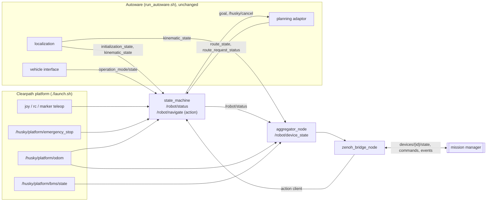
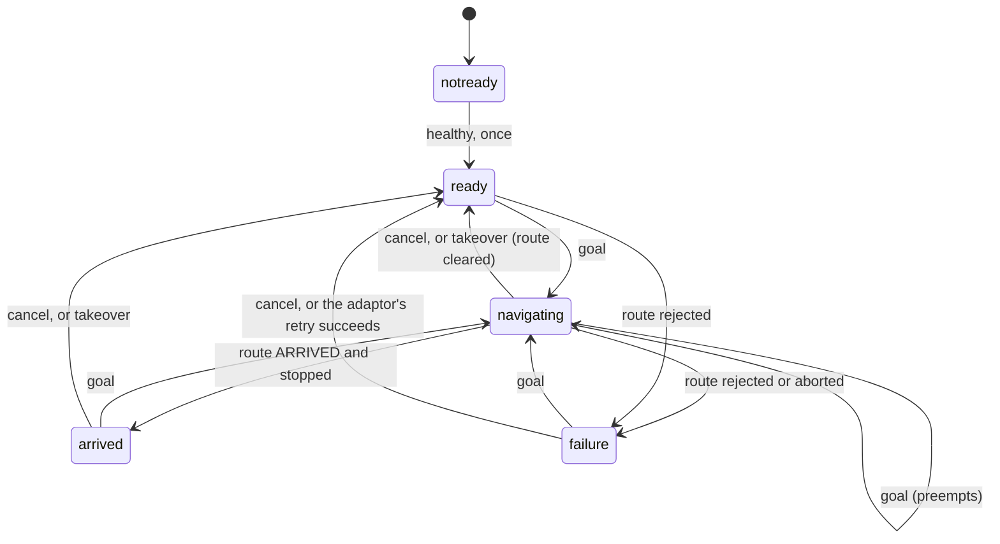

# Robot status design

Status: **implemented**, 2026-11-04, on `fix/state-machine` in `state_machine`, `patrolknight_msgs` and `autoware`, and on `feat/husky-sm` in husky, `zenoh_bridge` and mission manager. Verified end to end against `dummy_robot`, not yet on the Husky. How it runs is in [`modules/zenoh_bridge/docs/aggregator_autoware.md`](../modules/zenoh_bridge/docs/aggregator_autoware.md).

One vocabulary for what the Husky is doing and who is driving it, used unchanged from the robot to the mission manager UI, and one owner for each fact.

## Why

What runs today, from the robot to the operator:

| Layer | Publishes | Values |
| --- | --- | --- |
| Autoware `robot_state` | `/autoware/robot_status` | `notready` `ready` `navigate` `reach` `failure` |
| `state_machine` | `/robot_status`, `/robot_mode` | same as above; `auto` `manual` `none` |
| `aggregator_node` | `operational_state`, `mode` | `notready` `idle` `navigating` `arrived` `failure` |
| mission manager | reads the above | adds its own `Ready` label for `idle` |

The problems:

1. **Three vocabularies and a mapping.** The aggregator's `status_map` turns `ready` into `idle` and `navigate` into `navigating`, and mission manager's UI turns `idle` back into "Ready".
2. **`reach` is an event in a state topic.** It is published once and replaced by `ready` 0.2 s later. Every consumer has to work around it: `robot_state` keeps three variables to deliver it, `state_machine` can miss it between two 0.2 s ticks, the aggregator holds `arrived` through `ready`, and mission manager guesses an arrival from "`arrived`, within 2 m, newer than the goal", which completes the next waypoint early when two waypoints are close.
3. **Manual control is only partly seen.** `state_machine` subscribes to `/husky/joy_teleop/cmd_vel` only. RC and the interactive marker drive the robot through `twist_mux` without showing as `manual`, with or without Autoware running.
4. **Manual can't be taken from Autoware.** The vehicle interface's `/vehicle/status/control_mode` reads `MANUAL` whenever Autoware isn't driving, including after every arrival (it requests Local mode on `ARRIVED`). And when only `./launch.sh` runs, without Autoware, nothing Autoware publishes exists while RC can still drive the robot.
5. **Health is latched.** Since autoware `948c4bef`, `robot_state` reports `notready` only until readiness is first established; a LiDAR or IMU that dies later no longer shows. Kept for now, see [Known issues](#known-issues).
6. **No goal identity.** Mission manager can't tell which goal an `arrived` or `failure` belongs to, so it relies on distance, timestamps and a 60 s re-send timeout.
7. **No reason.** `notready` and `failure` don't say why, so the UI can only say "the robot is not ready".

## Principles

1. **One vocabulary.** The same strings in ROS, Zenoh JSON and mission manager. No mapping, no remap, no hold.
2. **One owner per fact.** The node that knows a fact publishes it; nobody else infers it.
3. **States are states, events are events.** `arrived` lasts until something changes it. "This goal finished" is a result carrying the goal's id.
4. **Independent of Autoware where the fact is.** Who drives the robot and whether it is e-stopped are platform facts. They are reported whenever `./launch.sh` runs, with or without Autoware.
5. **Pure core, thin node.** The rules are plain functions with plain inputs, tested without ROS; nodes do I/O only.

## Vocabulary

### `state`: what the robot is doing

| Value | Meaning | Mission can start |
| --- | --- | --- |
| `notready` | Autoware isn't running, the robot isn't localized, or a sensor is stale. `reason` says which. | no |
| `ready` | Healthy, no active goal. | yes |
| `navigating` | Route set or rerouting with Autoware in control, or arrived but still rolling to a stop. | yes (it is the mission's own goal) |
| `arrived` | The last goal's route is `ARRIVED` and the robot has stopped. Lasts until the next goal, a cancel or a takeover. | yes |
| `failure` | The last goal could not be routed or its route was aborted. Lasts until a new goal or a cancel. `reason` says which. | no |

### `mode`: who is in control

| Value | Meaning | Source |
| --- | --- | --- |
| `estop` | The emergency stop is engaged. | `/husky/platform/emergency_stop` (Clearpath) |
| `manual` | A teleop command (joystick, RC or interactive marker) within the last `manual_hold_s` (1 s). | the teleop topics (Clearpath `twist_mux` inputs) |
| `auto` | Autoware's vehicle interface has autonomous control. | `/system/operation_mode/state`: `AUTONOMOUS` and `is_autoware_control_enabled` |
| `none` | Nobody. | — |

Evaluated in that order: an e-stop beats a joystick, a joystick beats Autoware. `estop` and `manual` come from Clearpath topics only, so they work without Autoware.

`state` and `mode` are separate fields. A joystick takeover clears the route (the vehicle interface does that), so it reads `ready` + `manual`. An e-stop mid-route disables Autoware's control, so it reads `ready` + `estop` while the route is still set.

### `reason`

Empty unless `state` is `notready` or `failure`. Machine-readable, one value:

| `state` | `reason` |
| --- | --- |
| `notready` | `autoware_unavailable`, `not_localized`, `lidar_stale`, `imu_stale`, `odom_stale`, `status_stale` (set by the aggregator) |
| `failure` | `route_rejected`, `route_aborted` |

### `goal_id`

The id of the active or last goal, as given by whoever sent it (mission manager's command id). Empty for a goal sent from RViz.

## Architecture



| Fact | Owner | Everyone else |
| --- | --- | --- |
| `state`, `reason`, `goal_id` | `state_machine` | copies it |
| `mode` | `state_machine`, from Clearpath and Autoware topics | copies it |
| Goal outcome | `state_machine`'s `/robot/navigate` action result | `zenoh_bridge` reports it as a command event |
| Pose, speed, battery | `aggregator_node` | — |
| Staleness of the whole status | `aggregator_node` (`notready` / `status_stale`) | — |
| Route clearing on a takeover, retry of a rejected goal | Autoware (vehicle interface, adaptor), as today | `state_machine` observes it |

`state_machine` merges Autoware's `robot_state` and today's `state_machine` into one node in `modules/state_machine`, started by `./launch.sh` (it already is). It lives with the platform, not with Autoware, because principle 4 needs it running when Autoware isn't.

## Interfaces

In [`patrolknight_msgs`](https://github.com/patrol-knight/patrolknight_msgs), the shared message repo `zenoh_bridge` already depends on: it is public, so Docker and IoT builds clone it, and the husky repo pins it as the `modules/patrolknight_msgs` submodule. `state_machine` and `zenoh_bridge` depend on it.

```
# patrolknight_msgs/msg/RobotStatus.msg
builtin_interfaces/Time stamp
string state    # notready ready navigating arrived failure
string mode     # estop manual auto none
string reason   # empty unless notready / failure
string goal_id  # empty for a goal not sent through /robot/navigate
```

```
# patrolknight_msgs/action/NavigateToGoal.action
string goal_id
geometry_msgs/PoseStamped pose
---
string reason   # empty on success
---
string state    # feedback: the current state
```

| Topic / action | Type | QoS | Rate |
| --- | --- | --- | --- |
| `/robot/status` | `RobotStatus` | reliable, transient-local, depth 1 | on every change, and 1 Hz |
| `/robot/navigate` | `NavigateToGoal` | action defaults | — |
| `/robot/device_state` | `zenoh_bridge_msgs/RobotDeviceState` (today's `RobotState`, renamed) | reliable, depth 10 | 5 Hz and on a status change |

The aggregator's output is renamed from `/robot/state` to `/robot/device_state` so it can't be confused with `/robot/status`; it is what becomes `devices/{id}/state`.

## state_machine

### Inputs

| Input | Topic | Used for |
| --- | --- | --- |
| Localization | `/localization/initialization_state` | `not_localized` |
| LiDAR, IMU | `/sensing/lidar/obstacle_stop`, `/sensing/imu/imu_data` | `lidar_stale`, `imu_stale` |
| Wheel odometry | `/husky/platform/odom` | `odom_stale`; the stop check for `arrived` |
| Autoware alive | `/system/operation_mode/state` (periodic from the vehicle interface) | `autoware_unavailable`; `mode: auto` |
| Route | `/planning/route_state`, `/planning/route_request_status` | `navigating`, `arrived`, `failure` |
| Teleop | `teleop_topics` parameter, default `/husky/joy_teleop/cmd_vel`, `/husky/rc_teleop/cmd_vel`, `/husky/twist_marker_server/cmd_vel` (the `twist_mux` inputs) | `mode: manual` |
| E-stop | `/husky/platform/emergency_stop` | `mode: estop` |

The stop check uses wheel odometry rather than `/vehicle/status/velocity_status`, so it doesn't depend on one more Autoware node.

### State

`StatusCore::status(now)`, in order:

1. **Failure latch** → `failure` and its reason.
2. **Readiness.** Until it is first established, the first failing check gives `notready` and its reason: `autoware_unavailable` (no localization state yet), `not_localized`, `lidar_stale`, `imu_stale`, `odom_stale`. A sensor counts as stale after `sensor_timeout_s` (5 s) without a message. **Once established it is not checked again**, as in autoware `948c4bef`; see [Known issues](#known-issues).
3. **Cancelled**, until the route is `UNSET` → `ready` (route updates still in flight are ignored).
4. **Route `ARRIVED`** → `arrived` once a wheel odometry sample after the arrival is stopped on every axis; `navigating` until then.
5. **Route `SET` / `REROUTING`** with Autoware in control → `navigating`.
6. Otherwise `ready`.

Latches: `failure` (set by `route_request_status: rejected` or route `ABORTED`; cleared by a new goal, a cancel, or the adaptor's successful retry) and the active `goal_id`. Nothing else is remembered; `arrived` follows the route state, which stays `ARRIVED` until the next route.



### Mode

`StatusCore::mode(now)`: `estop` if the e-stop is engaged; else `manual` if any teleop topic had a message within `manual_hold_s` (1 s, the vehicle interface's value); else `auto` if the operation mode is `AUTONOMOUS` with Autoware control enabled and fresh; else `none`.

### Navigation action

`/robot/navigate` serves one goal at a time.

| Event | `state_machine` does | Action result |
| --- | --- | --- |
| Goal while `notready`, or `mode` is `manual` / `estop` | nothing | accepted and `ABORTED` at once, `reason` = the state's reason or the mode (a plain rejection carries no reason) |
| Goal accepted | publishes it on `/planning/mission_planning/goal` | — |
| No `pending` / `accepted` on `route_request_status` within 2 s (the adaptor drops a goal while a request is in flight) | — | `ABORTED`, `goal_dropped` |
| `arrived` | — | `SUCCEEDED` |
| `failure` | — | `ABORTED`, `route_rejected` / `route_aborted` |
| Route cleared during a teleop command (takeover) | — | `ABORTED`, `manual_takeover` |
| Route cleared otherwise | — | `ABORTED`, `route_cleared` |
| Someone else's `/husky/cancel` | — | `ABORTED`, `cancelled` |
| A newer goal | the new goal replaces the route | old goal `ABORTED`, `preempted` |
| Cancel request | publishes `/husky/cancel` | `CANCELED` once the route is `UNSET` |

A goal sent from RViz bypasses the action; `/robot/status` still shows it as `navigating` with an empty `goal_id`.

### Without Autoware

With only `./launch.sh`, before Autoware has ever reported: `state: notready`, `reason: autoware_unavailable`, and `mode` still `manual` while someone drives with the joystick, RC or the marker, `estop` when the e-stop is pressed. Mission manager shows the robot, why it can't take a mission, and who is driving it.

`state_machine` imports Autoware's message packages (`autoware_adapi_v1_msgs`, `autoware_planning_msgs`), so the husky workspace keeps building on top of the Autoware install, as it does today.

## aggregator_node

- Copies `RobotStatus` into `RobotDeviceState` unchanged. `StatusMapping`, `status_map`, `status_hold` and `status_stale` are removed.
- One rule left: no `/robot/status` for `stale_timeout_sec` (2 s) → `state: notready`, `reason: status_stale`, `mode` empty. This covers `state_machine` itself dying.
- Pose, speed and battery as today, plus the `BatteryFilter` described in the [battery notes](../modules/zenoh_bridge/docs/aggregator_autoware.md#battery).

## zenoh_bridge_node

`devices/{id}/state`:

```json
{
  "device_id": "husky",
  "type": "robot",
  "pose": { "frame_id": "map", "x": 12.3, "y": -4.1, "yaw": 1.57 },
  "timestamp": 1793347200.2,
  "battery": 76.0,
  "speed": 0.8,
  "status": { "state": "navigating", "mode": "auto", "reason": null, "goal_id": "cmd-42" }
}
```

`NavigationRelayComponent` is an action client of `/robot/navigate`. `navigate_to_goal` sends a goal with the command id as `goal_id`; `cancel_navigation` cancels it (or publishes `/husky/cancel` when there is no goal). `devices/{id}/events` reports `accepted`, `running` once `state_machine` has the goal, then `succeeded` on arrival or `failed` with the reason as `code` (`canceled` for a cancel; the contract has no separate status).

## Mission manager

- Reads `status.state`, `status.mode`, `status.reason`, `status.goal_id`. `operational_state` and `idle` are gone.
- **Arrival and failure come from the command result** of the goal it sent. The 2 m / newer-than-goal check and the held-`arrived` workaround are removed. `goal_dropped` and `state_machine_unavailable` send the goal again, as does no `running` result within `navigation_timeout_sec` (10 s); `preempted` is ignored.
- A mission can start when `state` is `ready`, `navigating` or `arrived` and `mode` is `none` or `auto`.
- A running mission aborts on any other `failed` result (no cancel), on `manual` or `failure` (no cancel: the route is already cleared, or kept for the operator), and on `notready` or `estop` (with a cancel: an e-stop leaves the route set).
- UI: the Start hint uses `reason` ("Autoware is not running", "No status from the robot", …); the mode pill shows for `auto`, `manual` and `estop`.

## dummy_robot

Fakes **Autoware and Clearpath's topics**, not the status: `route_state`, `route_request_status`, `initialization_state`, `operation_mode/state`, `kinematic_state`, sensor heartbeats, `platform/odom`, `bms/state`, `emergency_stop`. The real `state_machine` runs on top of it unchanged, so what is tested in docker is what runs on the robot. Autoware's message packages come from the Humble apt mirror (`ros-humble-autoware-adapi-v1-msgs`, `ros-humble-autoware-planning-msgs`).

## What goes away

- Autoware `robot_state` (the RViz `RobotStatusPanel` reads `/robot/status` instead), `REACH_DELIVERY_S`, the `reach` delivery variables and the `cancelled` flag.
- `state_machine`'s `/robot_status` and `/robot_mode`.
- The aggregator's `StatusMapping` and hold.
- Mission manager's distance-based arrival, held-`arrived` handling and cancel-or-not table.

Autoware's vehicle interface and adaptor are not changed.

## Migration

Each step is usable on its own:

1. **`RobotStatus` / `NavigateToGoal` in `patrolknight_msgs`, and the new `state_machine`** in C++, with gtest for `StatusCore` (status, mode and each goal outcome). Done.
2. **`dummy_robot` fakes Autoware's topics**; the new `state_machine` runs on it in docker. Done.
3. **Contract change**: aggregator passthrough and `/robot/device_state`, `zenoh_bridge` action client and the new JSON keys, mission manager reading them. Done, verified end to end against `dummy_robot`.
4. **On the Husky**: the checks below, plus the battery drive test.
5. **Autoware**: remove `robot_state`, its launch argument and the RViz `RobotStatusPanel` / `RobotModePanel`. Done. The panels read `std_msgs/String` and RViz runs with only the Autoware workspace sourced; a panel for `/robot/status` would need RViz started with the husky workspace sourced.

Every step changes what the next layer reads, so they merge together, in dependency order: `patrolknight_msgs`, `state_machine`, `zenoh_bridge`, mission manager, husky (submodule bumps), then `autoware`.

## Verification

| Case | Expect in mission manager |
| --- | --- |
| `./launch.sh` only, robot still | Not ready, "Autoware unavailable", no mode pill |
| `./launch.sh` only, RC driving | Not ready + Manual |
| E-stop pressed | Estop pill, Start blocked |
| Autoware up, localized | Ready |
| Mission | Navigating + Auto → Arrived → next waypoint on the `succeeded` event, also with waypoints < 2 m apart |
| Joystick or RC mid-mission | Ready + Manual, mission aborted with `manual_takeover` |
| LiDAR unplugged mid-mission | Today: nothing (readiness is latched, see Known issues). Once fixed: Not ready, "LiDAR stale", robot stopped, mission aborted |
| Goal off the map | Failure, "Route rejected", mission aborted |
| Cancel | Ready, robot stopped, event `canceled` |
| `state_machine` killed | Not ready, "Status stale" within 2 s |

## Known issues

- **Readiness is latched** (kept from autoware `948c4bef` on purpose for now). After readiness is first established, a LiDAR, IMU or wheel odometry that goes stale, lost localization, or Autoware stopping keeps reporting `ready` / `navigating`. Mission manager doesn't show it and doesn't abort the mission; the robot relies on Autoware's own safety (the vehicle interface stops on stale odometry and tracking). To fix: check health continuously in `StatusCore::status`, abort the active goal with the health reason, and publish `/husky/cancel`. Whatever made the latch necessary (a topic that flaps) gets a longer timeout or leaves the check, rather than the whole check being latched.

## Open questions

1. **Why was health latched in `948c4bef`?** Needed to fix the known issue above. To agree with the teammate.
2. **E-stop release mid-route.** Does the vehicle interface re-enable autonomy, or does the route need a new goal? This decides whether mission manager pauses or aborts on `estop`.
3. **The adaptor's retry.** A rejected goal is retried once per second and, on success, cleared without driving. With goal results, retrying is mission manager's call; the adaptor's retry could be turned off for goals that come through `/robot/navigate`.
