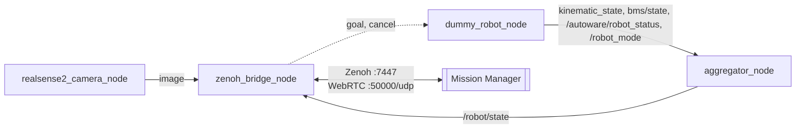
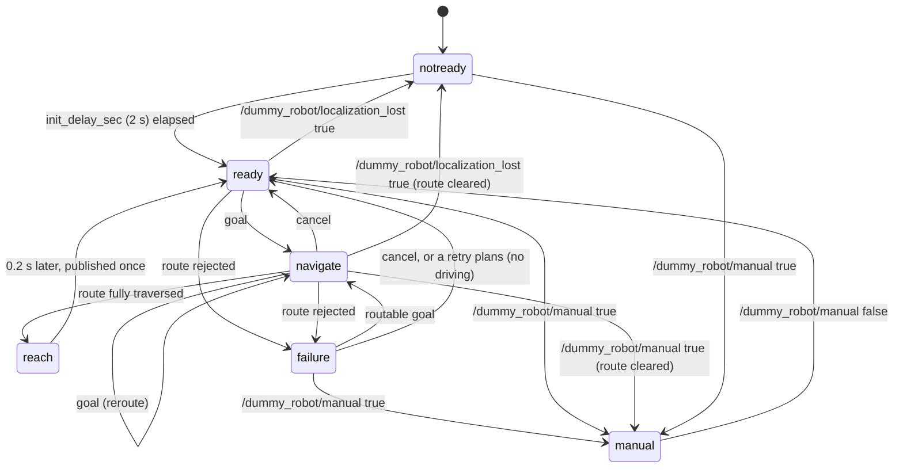

# Dummy Robot

A stand-in for the Husky that lets you test the robot-side dataflow to Mission Manager without the real robot. `dummy_robot_node` takes Autoware's place: it plans a route on the lanelet2 map, drives along it at a constant speed and reports its state on the **same topics, types and `/autoware/robot_status` values as the real Husky**, so `aggregator_node` and `zenoh_bridge_node` run with the same config on both. It's a deterministic fake, not a physics simulator. Everything downstream (`aggregator_node`, `zenoh_bridge_node`) is the same code the Husky runs.

Runs on x86_64 and on the Orin (arm64).



Three containers: `dummy_robot`, `zenoh_bridge` (`zenoh_bridge_node` + `aggregator_node`) and `realsense`.

## Quick start

Start Mission Manager first (it provides `zenohd`).

```bash
cd ../mission_manager && docker compose up -d --build
```

Then, from this directory:

```bash
./launch.sh up                    # dummy_robot + zenoh_bridge + realsense
./launch.sh up realsense:=false   # no camera: video shows a NO SIGNAL test pattern
./launch.sh build                 # build images only
./launch.sh down
```

Open <http://localhost:5050>. `husky-sim-01` shows up on the map, and you can send it goals and open its camera.

The lanelet2 map is the robot's own copy in `maps/`, the same way a real robot carries its own Autoware map. It has to match Mission Manager's map (`mission_manager/backend/storage/maps`), so update both together.

## State machine

Mirrors the Husky's `robot_state` node (`/autoware/robot_status`):



- `/localization/kinematic_state` is only published once "localized" (after `init_delay_sec`), like Autoware. Until then the robot shows offline in Mission Manager.
- A goal while `notready` or `manual` is ignored, as on the real robot. A manual takeover gets the robot out of `failure`: the operator drives it clear and releases it to `ready`.
- A goal is a route request that takes `route_request_sec` (0.5 s). A goal that arrives while one is in flight is dropped with a log warning and no feedback, like Autoware's adaptor.
- A route is rejected when the goal is off the lanelet map or `/dummy_robot/route_reject` is true. The failed goal is retried from the current pose once per second; when a retry plans, the robot goes back to `ready` without driving, like the adaptor.
- `/dummy_robot/localization_lost` true stops `/localization/kinematic_state` (the robot shows offline after `stale_timeout_sec`), drops the route and reports `notready`. The real robot's route handling here is assumed, not taken from Autoware.
- `/autoware/robot_status` is published at 5 Hz and on every change (reliable, transient-local). `reach` is published once.

`aggregator_node` turns this into `operational_state`: `notready`, `idle`, `navigating`, `arrived` (held through `ready` until the next state), `manual`, `failure`.

Test hooks (`false` to release):

```bash
ros2 topic pub --once /dummy_robot/manual std_msgs/msg/Bool "{data: true}"             # joystick takeover
ros2 topic pub --once /dummy_robot/route_reject std_msgs/msg/Bool "{data: true}"       # planner rejects routes
ros2 topic pub --once /dummy_robot/localization_lost std_msgs/msg/Bool "{data: true}"  # localization lost
```

### Command lifecycle

zenoh_bridge reports each command on `devices/{device_id}/events`:

| Command | Results |
|---|---|
| `navigate_to_goal` | `accepted` → `running` (goal published) → `succeeded` when `operational_state` changes to `arrived`. No timeout |
| `cancel_navigation` | `accepted` → `succeeded` once the cancel is published. A pending `navigate_to_goal` is dropped |

Only one `navigate_to_goal` is outstanding at a time. A new one replaces the last.

### Topics

| Topic | Type | | Real Husky |
|---|---|---|---|
| `/localization/kinematic_state` | `nav_msgs/Odometry` (`map`, body-frame twist) | pub | Autoware |
| `/husky/platform/odom` | `nav_msgs/Odometry` (body-frame twist; always, localized or not) | pub | Clearpath `diff_drive_controller` |
| `/husky/platform/bms/state` | `sensor_msgs/BatteryState` (`percentage` 0–1) | pub | Clearpath driver |
| `/autoware/robot_status` | `std_msgs/String`: `notready` / `ready` / `navigate` / `reach` / `manual` / `failure` | pub | `robot_state` |
| `/robot_mode` | `std_msgs/String`: `auto` while navigating, `manual` while manual, otherwise `none` | pub | `state_machine` |
| `/planning/mission_planning/goal` | `geometry_msgs/PoseStamped` | sub | Autoware adaptor |
| `/husky/cancel` | `std_msgs/Header` | sub | state machine node |
| `/dummy_robot/manual` | `std_msgs/Bool` | sub | (test hook, stands in for the joystick) |
| `/dummy_robot/route_reject` | `std_msgs/Bool` | sub | (test hook, planner rejecting routes) |
| `/dummy_robot/localization_lost` | `std_msgs/Bool` | sub | (test hook, localization lost) |

### ROS domain

The containers default to `ROS_DOMAIN_ID=42`. The topic names are the real robot's, and DDS discovery crosses the LAN, so on domain 0 a dummy on your laptop would publish into the Husky. Set `ROS_DOMAIN_ID` to override.

## Keeping it in sync with the real robot

If the Husky's topics or `/autoware/robot_status` values change, change `dummy_robot_node.cpp` to match, together with `modules/zenoh_bridge/src/aggregator/config/sources.yaml` (topics, status map) and `navigation_route()` in `modules/zenoh_bridge/src/zenoh_bridge/src/zenoh_bridge.cpp` (goal/cancel).
