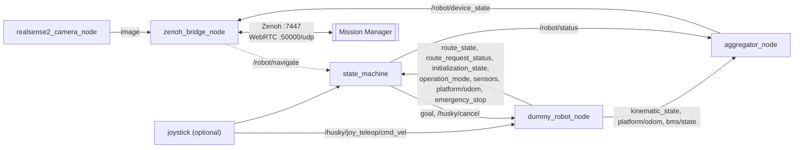

# Dummy Robot

A stand-in for the Husky that lets you test the robot-side dataflow to Mission Manager without the real robot. `dummy_robot_node` takes the place of Autoware (localization, the planning adaptor, the Husky vehicle interface) and the Clearpath driver: it plans a route on the lanelet2 map, drives along it at a constant speed, hands over to a joystick, and publishes **the same topics and types as the real Husky**. It's a deterministic fake, not a physics simulator. Everything downstream (`state_machine`, `aggregator_node`, `zenoh_bridge_node`) is the same code the Husky runs.

Runs on x86_64 and on the Orin (arm64).



Four containers: `dummy_robot`, `state_machine` (`modules/state_machine`), `zenoh_bridge` (`zenoh_bridge_node` + `aggregator_node`) and `realsense`. `state_machine` and `zenoh_bridge` build with the husky repo's `modules/patrolknight_msgs`, so run `git submodule update --init --recursive` first.

## Quick start

Start Mission Manager first (it provides `zenohd`).

```bash
cd ../mission_manager && docker compose up -d --build
```

Then, from this directory:

```bash
./launch.sh up                    # dummy_robot + state_machine + zenoh_bridge + realsense
./launch.sh up realsense:=false   # no camera: video shows a NO SIGNAL test pattern
./launch.sh build                 # build images only
./launch.sh down
```

Open <http://localhost:5050>. `husky-sim-01` shows up on the map, and you can send it goals and open its camera.

The lanelet2 map is the robot's own copy in `maps/`, the same way a real robot carries its own Autoware map. It is Mission Manager's demo map (`mission_manager/backend/storage/maps/nsh`), so update both together. The start pose in `config/dummy_robot.yaml` is on its lanelets.

## What it fakes

- **Localization**: `/localization/initialization_state` goes `INITIALIZED` after `init_delay_sec` (2 s); only then are `/localization/kinematic_state` and the LiDAR / IMU heartbeats (`/sensing/lidar/obstacle_stop`, `/sensing/imu/imu_data`) published. A pose on `/initialpose` moves the robot there and repeats that delay, like Autoware stopping localization while it aligns.
- **Planning adaptor**: a goal on `/planning/mission_planning/goal` publishes `pending` and route `ROUTING`; `route_request_sec` (0.5 s) later the route is `SET` and `accepted`, or `rejected` when the goal is off the lanelet map or `/dummy_robot/route_reject` is true. A goal while a request is in flight is dropped. A rejected goal is retried once per second; when a retry plans, it reports `accepted` and leaves the route `UNSET`, like the adaptor. A cancel publishes `cancelled` and clears the route.
- **Vehicle interface**: `/system/operation_mode/state` is `AUTONOMOUS` with control enabled while the route is set and nobody overrides it, `STOP` under e-stop, else `LOCAL`. A `Twist` on any teleop topic (`joy_teleop`, `rc_teleop`, `twist_marker_server`) clears the route and drives the robot by that twist while commands keep coming (0.25 s); goals within 1 s of one are ignored.
- **Driving**: along the route at `speed_mps`; at the end the route is `ARRIVED` and the robot stops.
- **Clearpath**: `/husky/platform/odom` always, `/husky/platform/bms/state` at 1 Hz, `/husky/platform/emergency_stop` from `/dummy_robot/estop`.

`state_machine` turns these into `/robot/status`; see its README.

Test hooks, run inside any of the containers (`docker compose exec state_machine bash`, then `source /opt/ros/humble/setup.bash`):

```bash
ros2 topic pub -r 10 /husky/joy_teleop/cmd_vel geometry_msgs/msg/Twist "{linear: {x: 0.5}}"  # joystick, Ctrl-C to release
ros2 topic pub --once /dummy_robot/route_reject std_msgs/msg/Bool "{data: true}"             # planner rejects routes
ros2 topic pub --once /dummy_robot/reroute_refuse std_msgs/msg/Bool "{data: true}"           # like Autoware: a goal mid-route gets pending, the old route stays
ros2 topic pub --once /dummy_robot/estop std_msgs/msg/Bool "{data: true}"                    # e-stop pressed
ros2 topic pub --once /dummy_robot/localization_lost std_msgs/msg/Bool "{data: true}"        # localization lost
ros2 topic pub --once /dummy_robot/obstacle std_msgs/msg/Bool "{data: true}"                 # obstacle ahead: blocked until false
ros2 topic pub --once /dummy_robot/control_fault std_msgs/msg/Bool "{data: true}"            # Autoware loses control: not_moving after 10 s
```

A real joystick works too: run the joystick teleop on the same `ROS_DOMAIN_ID` (see [ROS domain](#ros-domain)).

## Topics

| Topic | Type | | Real Husky |
|---|---|---|---|
| `/localization/kinematic_state` | `nav_msgs/Odometry` (`map`, body-frame twist) | pub | Autoware |
| `/localization/initialization_state` | `autoware_adapi_v1_msgs/LocalizationInitializationState` | pub | Autoware |
| `/sensing/lidar/obstacle_stop`, `/sensing/imu/imu_data` | `std_msgs/Bool`, `sensor_msgs/Imu` | pub | Autoware sensing |
| `/planning/route_state` | `autoware_planning_msgs/RouteState` | pub | Autoware mission planner |
| `/planning/route_request_status` | `std_msgs/String`: `pending` / `accepted` / `rejected` / `cancelled` | pub | planning adaptor |
| `/system/operation_mode/state` | `autoware_adapi_v1_msgs/OperationModeState` | pub | vehicle interface |
| `/husky/platform/odom` | `nav_msgs/Odometry` (body-frame twist) | pub | Clearpath `diff_drive_controller` |
| `/husky/platform/bms/state` | `sensor_msgs/BatteryState` (`percentage` 0–1) | pub | Clearpath driver |
| `/husky/platform/emergency_stop` | `std_msgs/Bool` | pub | Clearpath MCU |
| `/planning/mission_planning/goal` | `geometry_msgs/PoseStamped` | sub | planning adaptor |
| `/initialpose` | `geometry_msgs/PoseWithCovarianceStamped` | sub | Autoware |
| `/husky/cancel` | `std_msgs/Header` | sub | adaptor, vehicle interface |
| `/husky/joy_teleop/cmd_vel`, `/husky/rc_teleop/cmd_vel`, `/husky/twist_marker_server/cmd_vel` | `geometry_msgs/Twist` | sub | vehicle interface (takeover) |
| `/dummy_robot/route_reject`, `/dummy_robot/estop`, `/dummy_robot/localization_lost` | `std_msgs/Bool` | sub | (test hooks) |

## ROS domain

The containers default to `ROS_DOMAIN_ID=42`. The topic names are the real robot's, and DDS discovery crosses the LAN, so on the Husky's domain (77) a dummy on your laptop would publish into the Husky. Set `ROS_DOMAIN_ID` to override, e.g. to drive the dummy with a joystick teleop on another domain, but only while the Husky is off the network.

## Keeping it in sync with the real robot

If the Husky's Autoware or Clearpath topics change, change `dummy_robot_node.cpp` to match, together with `state_machine`'s parameters and `modules/zenoh_bridge/src/aggregator/config/sources.yaml`.
