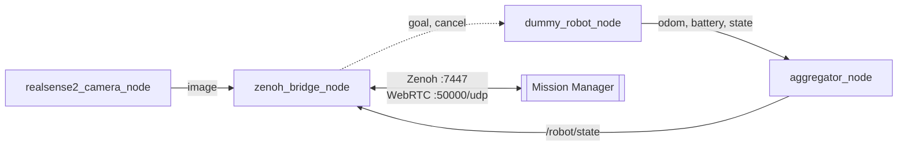
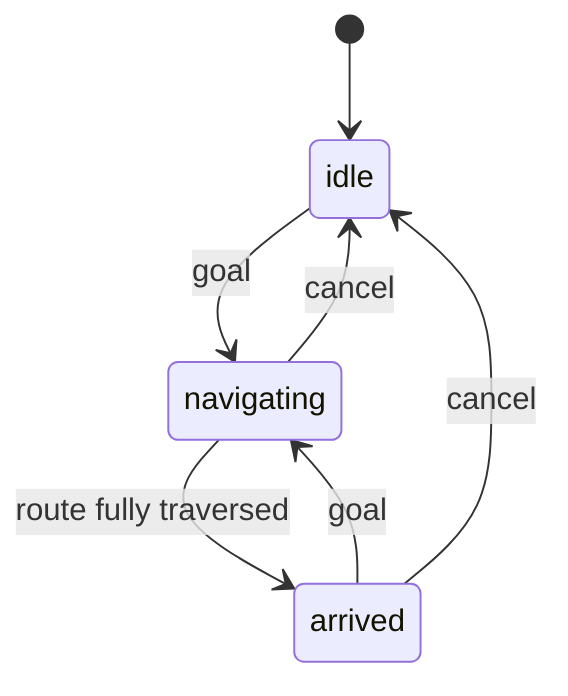

# Dummy Robot

A stand-in for the Husky that lets you test the robot-side dataflow to Mission Manager without the real robot. `dummy_robot_node` takes Autoware's place: it plans a route on the lanelet2 map, drives along it at a constant speed and reports its state. It's a deterministic fake, not a physics simulator. Everything downstream (`aggregator_node`, `zenoh_bridge_node`) is the same code the Husky runs.

Runs on x86_64 and on the Orin (arm64).



Three containers: `dummy_robot`, `zenoh_bridge` (`zenoh_bridge_node` + `aggregator_node`) and `realsense`.

## Quick start

Start Mission Manager first (it provides `zenohd`).

```bash
cd ../mission_manager && docker compose up -d --build
```

Then, from this directory:

```bash
./launch.sh up                    # dummy_robot + zenoh_bridge + realsense
./launch.sh up realsense:=false   # no camera: video shows a NO SIGNAL test pattern
./launch.sh build                 # build images only
./launch.sh down
```

Open <http://localhost:5050>. `husky-sim-01` shows up on the map, and you can send it goals and open its camera.

The lanelet2 map is the robot's own copy in `maps/`, the same way a real robot carries its own Autoware map. It has to match Mission Manager's map (`mission_manager/backend/storage/maps`), so update both together.

## State machine



These don't change the state:

- a goal with no route on the map: logged and ignored
- the map failed to load at startup: every goal is rejected
- a stale goal or cancel (see Sequencing): logged and ignored

`operational_state` is published every tick (10 Hz), whether or not it changed. zenoh_bridge only reacts to real transitions, so a replacement stack can publish the same way.

### Command lifecycle

zenoh_bridge reports each command on `devices/{device_id}/events`:

| Command | Results |
|---|---|
| `navigate_to_goal` | `accepted` → `running` (goal published) → `succeeded` when `operational_state` changes to `arrived`, or `failed` after 120 s |
| `cancel_navigation` | `accepted` → `succeeded` once the cancel is published. A pending `navigate_to_goal` is dropped |

Only one `navigate_to_goal` is outstanding at a time. A new one replaces the last.

Mission Manager sends one waypoint at a time and only sends the next one after the robot has arrived. If no arrival comes within `navigation_timeout_sec` (60 s), Mission Manager re-sends the same waypoint. The robot may still be driving when that happens, so a resent goal has to replace the current route cleanly.

### Sequencing

zenoh_bridge stamps goal and cancel with one shared sequence number in `header.stamp.sec` (not wall-clock time). The node ignores anything that isn't newer than the last one it applied, because DDS doesn't keep messages in order across two topics. Without this, a fast pause-then-resume could apply the resume's goal before the pause's cancel.

### Topics

| Topic | Type | |
|---|---|---|
| `/dummy_robot/odom` | `nav_msgs/Odometry` (`frame_id: map`) | pub |
| `/dummy_robot/battery_percent` | `std_msgs/Float32` | pub |
| `/dummy_robot/operational_state` | `std_msgs/String`: `idle` / `navigating` / `arrived` | pub |
| `/dummy_robot/goal` | `geometry_msgs/PoseStamped` | sub |
| `/dummy_robot/cancel` | `std_msgs/Header` | sub |

## Swapping in Autoware or the real robot

To plug in seamlessly, the new stack has to:

- publish pose, velocity, battery and an `idle` / `navigating` / `arrived` state, which it maps from its own states. Point the aggregator at those topics in `modules/zenoh_bridge/src/aggregator/config/sources.yaml`.
- accept a goal pose and a cancel, and drop stale ones using the sequence number above. The goal/cancel topic names live in `navigation_route()` in `modules/zenoh_bridge/src/zenoh_bridge/src/zenoh_bridge.cpp`.
- switch to `arrived` only once it's actually at the goal. That transition is what reports `succeeded`.
