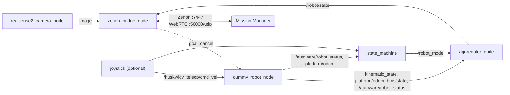
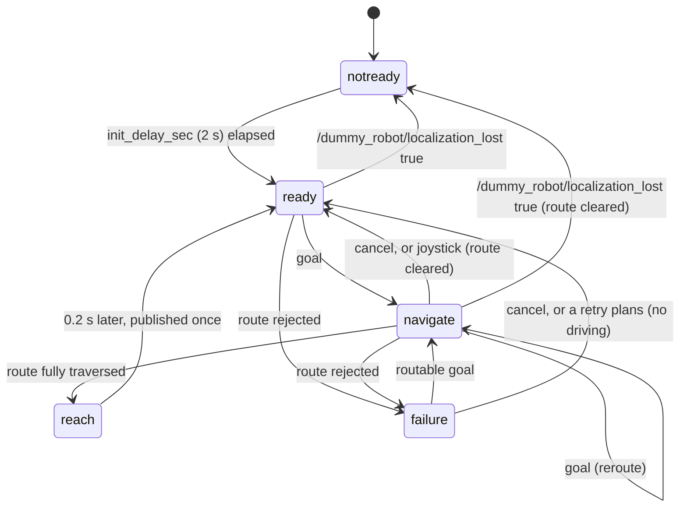

# Dummy Robot

A stand-in for the Husky that lets you test the robot-side dataflow to Mission Manager without the real robot. `dummy_robot_node` takes the place of Autoware (`robot_state`, the planning adaptor, the Husky vehicle interface) and the Clearpath driver: it plans a route on the lanelet2 map, drives along it at a constant speed, hands over to a joystick, and reports its state on the **same topics, types and `/autoware/robot_status` values as the real Husky**. It's a deterministic fake, not a physics simulator. Everything downstream (`state_machine`, `aggregator_node`, `zenoh_bridge_node`) is the same code the Husky runs.

Runs on x86_64 and on the Orin (arm64).



Four containers: `dummy_robot`, `state_machine` (the teammate's `modules/state_machine`, unchanged), `zenoh_bridge` (`zenoh_bridge_node` + `aggregator_node`) and `realsense`.

## Quick start

Start Mission Manager first (it provides `zenohd`).

```bash
cd ../mission_manager && docker compose up -d --build
```

Then, from this directory:

```bash
./launch.sh up                    # dummy_robot + state_machine + zenoh_bridge + realsense
./launch.sh up realsense:=false   # no camera: video shows a NO SIGNAL test pattern
./launch.sh build                 # build images only
./launch.sh down
```

Open <http://localhost:5050>. `husky-sim-01` shows up on the map, and you can send it goals and open its camera.

The lanelet2 map is the robot's own copy in `maps/`, the same way a real robot carries its own Autoware map. It is Mission Manager's demo map (`mission_manager/backend/storage/maps/nsh`), so update both together. The start pose in `config/dummy_robot.yaml` is on its lanelets.

## State machine

Mirrors the Husky's `robot_state` (`/autoware/robot_status`) together with the vehicle interface's joystick takeover:



- `/localization/kinematic_state` is only published once "localized" (after `init_delay_sec`), like Autoware. Until then Mission Manager shows the robot without a pose.
- **Joystick**: any `Twist` on `/husky/joy_teleop/cmd_vel` or `/husky/rc_teleop/cmd_vel` clears the route and drives the robot by that twist while commands keep coming (0.25 s timeout), like the vehicle interface. The status stays `ready` (there is no `manual` status); `state_machine` reports `/robot_mode: manual`. Goals within 1 s of the last joystick command are ignored. A `failure` stays under the joystick, as the adaptor keeps retrying.
- A goal while `notready` is ignored. A goal is a route request that takes `route_request_sec` (0.5 s); a goal that arrives while one is in flight is dropped with a log warning, like Autoware's adaptor.
- A route is rejected when the goal is off the lanelet map or `/dummy_robot/route_reject` is true. The failed goal is retried from the current pose once per second; when a retry plans, the robot goes back to `ready` without driving, like the adaptor.
- `/dummy_robot/localization_lost` true stops `/localization/kinematic_state`, drops the route and reports `notready`. The real robot's route handling here is assumed, not taken from Autoware.
- `/autoware/robot_status` is published at 5 Hz and on every change (reliable, transient-local). `reach` is published once.

`aggregator_node` turns this into `operational_state` (`notready`, `idle`, `navigating`, `arrived` held through `ready` until the next state, `failure`), and `state_machine`'s `/robot_mode` into `mode`.

Test hooks, run inside any of the containers (`docker compose exec state_machine bash`, then `source /opt/ros/humble/setup.bash`):

```bash
ros2 topic pub -r 10 /husky/joy_teleop/cmd_vel geometry_msgs/msg/Twist "{linear: {x: 0.5}}"  # joystick, Ctrl-C to release
ros2 topic pub --once /dummy_robot/route_reject std_msgs/msg/Bool "{data: true}"             # planner rejects routes
ros2 topic pub --once /dummy_robot/localization_lost std_msgs/msg/Bool "{data: true}"        # localization lost
```

A real joystick works too: run the joystick teleop on the same `ROS_DOMAIN_ID` (see [ROS domain](#ros-domain)).

### Command lifecycle

zenoh_bridge reports each command on `devices/{device_id}/events`: `accepted`, then `succeeded` once the goal or cancel is published. Mission Manager follows the navigation through `operational_state`, not these results.

### Topics

| Topic | Type | | Real Husky |
|---|---|---|---|
| `/localization/kinematic_state` | `nav_msgs/Odometry` (`map`, body-frame twist) | pub | Autoware |
| `/husky/platform/odom` | `nav_msgs/Odometry` (body-frame twist; always, localized or not) | pub | Clearpath `diff_drive_controller` |
| `/husky/platform/bms/state` | `sensor_msgs/BatteryState` (`percentage` 0–1) | pub | Clearpath driver |
| `/autoware/robot_status` | `std_msgs/String`: `notready` / `ready` / `navigate` / `reach` / `failure` | pub | `robot_state` |
| `/planning/mission_planning/goal` | `geometry_msgs/PoseStamped` | sub | Autoware adaptor |
| `/husky/cancel` | `std_msgs/Header` | sub | adaptor, `robot_state`, vehicle interface |
| `/husky/joy_teleop/cmd_vel`, `/husky/rc_teleop/cmd_vel` | `geometry_msgs/Twist` | sub | vehicle interface (manual takeover) |
| `/dummy_robot/route_reject` | `std_msgs/Bool` | sub | (test hook, planner rejecting routes) |
| `/dummy_robot/localization_lost` | `std_msgs/Bool` | sub | (test hook, localization lost) |

### ROS domain

The containers default to `ROS_DOMAIN_ID=42`. The topic names are the real robot's, and DDS discovery crosses the LAN, so on the Husky's domain (77) a dummy on your laptop would publish into the Husky. Set `ROS_DOMAIN_ID` to override, e.g. to drive the dummy with a joystick teleop on another domain, but only while the Husky is off the network.

## Keeping it in sync with the real robot

If the Husky's topics or `/autoware/robot_status` values change, change `dummy_robot_node.cpp` to match, together with `modules/zenoh_bridge/src/aggregator/config/sources.yaml` (topics, status map) and `NavigationTopics` in `modules/zenoh_bridge/src/zenoh_bridge/include/zenoh_bridge/navigation_relay_component.hpp` (goal/cancel).
