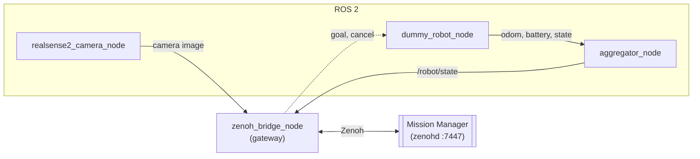
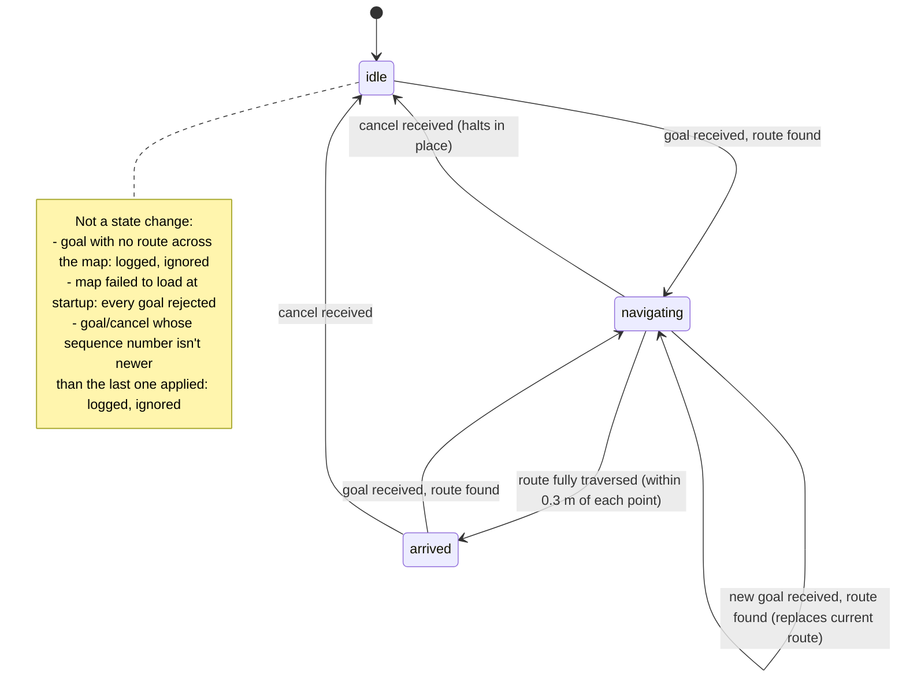

# Dummy Robot

A dev-machine stand-in for the Husky, used to test the robot-side dataflow
to Mission Manager end to end without the real robot. `dummy_robot_node`
takes the place of Autoware: it plans routes on the lanelet2 map, drives
toward goals, and reports its state. Everything downstream of it
(`aggregator_node`, `zenoh_bridge_node`) is the same code the Husky runs. It is a deterministic fake, not a physics simulator. It is x86_64-only:
PyPI's `lanelet2` wheel has no aarch64 build, so this never runs on the Orin.

## Pipeline



`zenoh_bridge_node` is the gateway: it's the only node that talks to Mission
Manager, over Zenoh. Everything to its left is plain ROS 2.

- **Camera:** `realsense2_camera_node` publishes the RealSense image, and `zenoh_bridge_node` streams it to the browser over WebRTC.
- **Robot:** `dummy_robot_node` publishes odom, battery and state, `aggregator_node` combines them into `/robot/state`, and `zenoh_bridge_node` publishes that to Mission Manager. Mission Manager's `navigate_to_goal`/`cancel_navigation` commands come back through the bridge to `dummy_robot_node` as goal/cancel.

These run in three containers: `realsense`, `dummy_robot`, and `zenoh_bridge` (which runs both `aggregator_node` and `zenoh_bridge_node`).

## Running

**Prerequisites**

The router doesn't need to be up first. `zenoh_bridge_node` logs a warning,
keeps retrying every second, and also reconnects on its own if the router
restarts.

**Start / stop** (from this directory):

```bash
./launch.sh up                        # dummy_robot + zenoh_bridge + realsense (default)
./launch.sh up realsense:=false       # no RealSense plugged in
./launch.sh build                     # build images only
./launch.sh down                      # stop + remove everything
```

`launch.sh` maps each `<node>:=<true|false>` argument to a compose profile.
Every service in `docker-compose.yml` has one, so a bare `docker compose up`
starts nothing. With `realsense:=true` but no camera plugged in, the
`realsense` container keeps logging `No RealSense devices were found!` and
waits.

**Connecting to another machine's router:** set `zenoh.connect` in
`config/zenoh_bridge.yaml` to `["tcp/<ip>:7447"]`. Inside Docker,
`tcp/localhost:7447` points at the container itself, so keep
`host.docker.internal` for a router on this same machine.

**Checking the dataflow without Mission Manager's UI**:

```bash
pip install eclipse-zenoh
python3 integration_test.py                       # router on this machine
python3 integration_test.py tcp/192.168.1.10:7447
```

This checks that robot state reaches Zenoh, that a `navigate_to_goal` is
accepted, running, then succeeded, and that the reported position ends up
at the goal.

## `dummy_robot_node`

On a new goal, it plans a route across the lanelet2 map from its current
position (`lanelet_router.py`) and drives along it at a constant speed. The
router is a trimmed, deliberately duplicated port of
`mission_manager/backend/core/map_server.py`'s routing logic: a robot's own
nav stack plans its own path from a goal position alone and never receives a
precomputed path from the backend.

### State machine



`operational_state` is republished on every tick (`update_rate_hz`, 10 Hz),
whether or not it changed. Consumers must not assume every `"arrived"` sample
belongs to the goal they just issued. `zenoh_bridge_node` only reacts to
actual transitions, and Mission Manager guards against it too: both
`MissionDriveCoordinator` and `AnomalyResponseCoordinator`
(`mission_manager/backend/core/mission_drive.py`, `anomaly_response.py`)
ignore state samples not newer than their goal's `issued_after_timestamp`.

### Command lifecycle

`zenoh_bridge_node` reports each command's progress as a `CommandResult` on
`devices/{device_id}/events`:

| Command | Results |
|---|---|
| `navigate_to_goal` | `accepted` → `running` (goal published on `/dummy_robot/goal`) → `succeeded` when `operational_state` changes to `"arrived"`, or `failed` ("timed out") after 120 s |
| `cancel_navigation` | `accepted` → `succeeded` ("cancelled"), after publishing on `/dummy_robot/cancel`. Any pending `navigate_to_goal` is dropped and never reports. |

Only one `navigate_to_goal` is outstanding at a time: a new one replaces the
previous one's request.

### Sequencing

`/dummy_robot/goal` and `/dummy_robot/cancel` are two separate topics, and DDS
only guarantees in-order delivery *within* a topic, not across two. So
`zenoh_bridge_node` stamps both messages' `header.stamp.sec` with one shared
monotonic counter (a sequence number, not wall-clock time), and this node
ignores anything not strictly newer than the last one it applied. A fast
pause-then-resume therefore can't have the resume's goal processed before the
pause's cancel.

### Topics

| Topic | Type | Direction |
|---|---|---|
| `/dummy_robot/odom` | `nav_msgs/Odometry` (`frame_id: map`) | published |
| `/dummy_robot/battery_percent` | `std_msgs/Float32` | published |
| `/dummy_robot/operational_state` | `std_msgs/String` (`idle` / `navigating` / `arrived`) | published |
| `/dummy_robot/goal` | `geometry_msgs/PoseStamped` | subscribed |
| `/dummy_robot/cancel` | `std_msgs/Header` | subscribed |

### Parameters

Set in `config/dummy_robot.yaml`, which is bind-mounted, so edits need no image rebuild.

| Param | Code default | `config/dummy_robot.yaml` | Meaning |
|---|---|---|---|
| `update_rate_hz` | 10.0 | — | Tick rate for publishing and route advancement |
| `x`, `y`, `yaw` | -55.01, 65.38, 0.0 | -67.34, 33.31, 0.0 | Starting pose. The config's is mission-1's home waypoint, a known in-lanelet point; an arbitrary point is very likely not on any lanelet. |
| `battery_cycle_sec` | 600.0 | — | Deterministic battery drain cycle (100% → 20%, repeating) |
| `speed_mps` | 1.5 | 4.0 | Constant driving speed while navigating |
| `map_osm_path`, `map_projector_path` | `/opt/zenoh_bridge_files/maps/...` | `/maps/...` | Lanelet2 map and projector info (`/maps` is the `MAP_DIR` mount) |

The bridge side is configured in `config/zenoh_bridge.yaml`: `device_id`
(`husky-sim-01`, distinct from the real Husky's so both can share one
router), `mode: robot`, and the Zenoh endpoint.

## Replacing it with Autoware or the real robot

Nothing downstream of `dummy_robot_node` has to change:

- **State:** point `aggregator_node` at the new stack's topics in `modules/zenoh_bridge/src/aggregator/config/sources.yaml`.
- **Commands:** the goal/cancel/watch topic names are one constant, `navigation_route()` in `modules/zenoh_bridge/src/zenoh_bridge/src/zenoh_bridge.cpp`.
