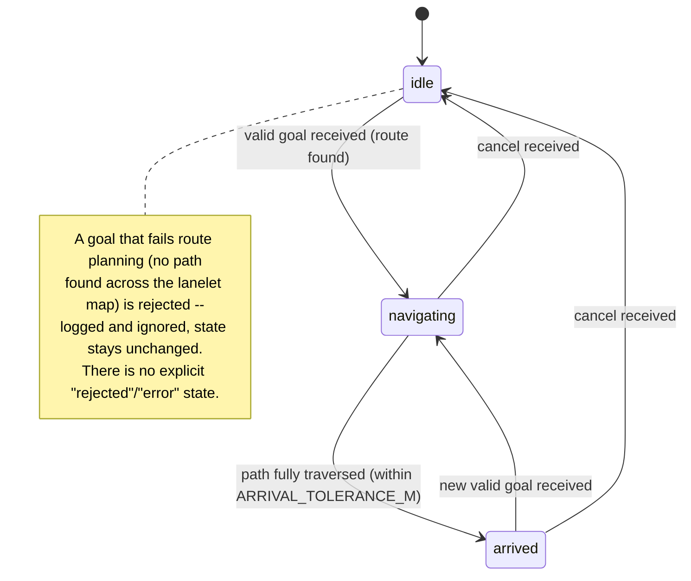

# Dummy Robot

Lanelet-aware fake robot node: a deterministic stand-in for a robot's own
onboard navigation stack, not a physics simulator. Publishes `/dummy_robot/odom`,
`/dummy_robot/battery_percent`, `/dummy_robot/operational_state`; subscribes
to `/dummy_robot/goal` (`geometry_msgs/PoseStamped`) and `/dummy_robot/cancel`
(`std_msgs/Header`), both published by `NavigationGatewayComponent` in
response to a `navigate_to_goal`/`cancel_navigation` Zenoh command from
Mission Manager. On a new goal, it plans a route across the lanelet2 map
(`lanelet_router.py` — a trimmed, deliberately-duplicated port of
`mission_manager/backend/core/map_server.py`'s routing logic; a robot's own
nav stack must plan its own path from a goal position alone, never receive a
precomputed path from the backend) and drives toward it at a constant speed
(`speed_mps`, default 1.5 m/s).

## State machine

`operational_state` is republished on every tick (`update_rate_hz`, default
10Hz) regardless of whether it actually changed since the last one —
consumers must not assume every `"arrived"` sample they observe corresponds
to a goal they just issued. See
`mission_manager/backend/core/anomaly_response.py`'s
`issued_after_timestamp`/position-check guards for a concrete case where
assuming that caused a real bug.

## Sequencing

`/dummy_robot/goal` and `/dummy_robot/cancel` are two separate
topics/subscriptions — DDS only guarantees in-order delivery *within* a
topic, not across two of them. `NavigationGatewayComponent` stamps both
messages' `header.stamp.sec` with the same monotonic counter (a sequence
number, not wall-clock time); this node ignores anything not strictly newer
than the last one actually applied, so a fast pause-then-resume can't have
the resume's goal processed before the pause's cancel.

## Parameters

| Param | Default | Meaning |
|---|---|---|
| `update_rate_hz` | 10.0 | Tick rate for odom/battery/state publishing and path advancement |
| `x`, `y`, `yaw` | map-specific | Starting pose |
| `battery_cycle_sec` | 600.0 | Deterministic battery drain cycle (100% → 20%, repeating) |
| `speed_mps` | 1.5 | Constant driving speed while navigating |
| `map_osm_path` / `map_projector_path` | `/opt/zenoh_bridge_files/maps/...` | Lanelet2 map + projector info for route planning |
